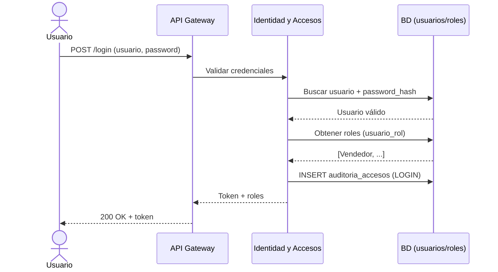
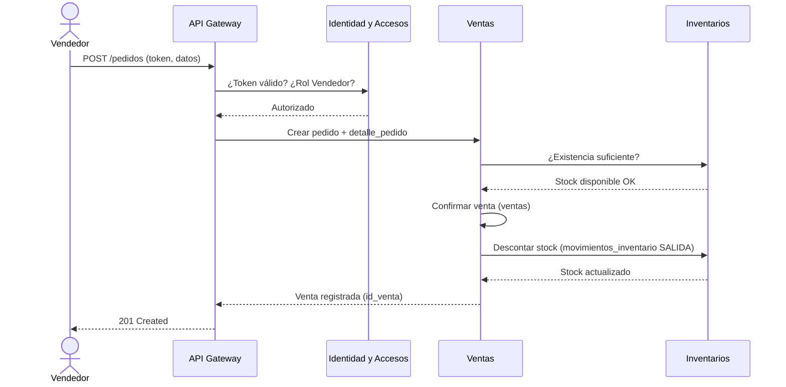
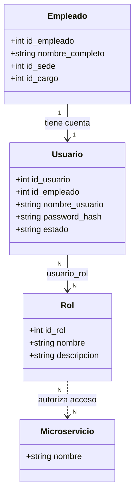

# Roles y Diagramas de Interacción con Microservicios

Este documento define los **roles de usuario** deducidos del modelo de datos y los representa mediante cuatro diagramas:

1. [Roles deducidos del modelo](#1-roles-deducidos-del-modelo)
2. [Diagrama de Casos de Uso](#2-diagrama-de-casos-de-uso-uml--plantuml) — qué puede hacer cada rol.
3. [Diagrama de Arquitectura / Componentes](#3-diagrama-de-arquitectura--componentes-mermaid) — cómo la petición pasa por Identidad hacia cada microservicio.
4. [Diagrama de Secuencia](#4-diagrama-de-secuencia-mermaid) — paso a paso de login y de una venta.
5. [Matriz RBAC + Diagrama de Clases](#5-matriz-rbac-y-modelo-de-roles) — qué rol accede a qué microservicio.

---

## 1. Roles deducidos del modelo

Los roles se infieren de **qué entidad ejecuta cada operación**, observando las claves foráneas `id_empleado` / `id_usuario` que aparecen en las tablas de cada microservicio.

| Rol | Evidencia en las tablas | Responsabilidades |
|---|---|---|
| **Administrador** | `sedes`, `almacenes`, `categorias`, `productos`, `usuarios`, `roles`, `usuario_rol` | Gestiona el catálogo maestro, crea usuarios y asigna roles. Configuración del sistema. |
| **Comprador** | `ordenes_compra.id_empleado`, `detalle_orden_compra`, `proveedores`, `producto_proveedor` | Gestiona proveedores y crea/gestiona órdenes de compra. |
| **Bodeguero** | `recepciones_compra`, `detalle_recepcion`, `inventarios`, `movimientos_inventario`, `ajustes_inventario.id_empleado`, `transferencias`, `detalles_transferencia` | Recibe mercancía, registra movimientos y ajustes de inventario, realiza transferencias entre almacenes. |
| **Vendedor** | `pedidos_venta.id_empleado`, `detalle_pedido`, `ventas`, `clientes` | Registra clientes, pedidos y confirma ventas. |
| **Cajero** | `pagos`, `devoluciones`, `detalle_devolucion` | Registra pagos de ventas y procesa devoluciones. |
| **Auditor** | `auditoria_accesos`, microservicio **Reportes** (solo lectura) | Consulta reportes y registros de auditoría. No modifica datos. |

> Estos roles se almacenan en la tabla `roles` y se asignan a cada usuario mediante `usuario_rol` (relación N:M), lo que permite que un mismo usuario tenga más de un rol (p. ej. un Jefe de Bodega que también sea Comprador).

---

## 2. Diagrama de Casos de Uso

Muestra qué funcionalidades (casos de uso), agrupadas por microservicio, puede ejecutar cada rol (actor).

---

## 3. Diagrama de Arquitectura / Componentes

Muestra cómo una petición del usuario pasa por el **API Gateway**, es **autenticada/autorizada por el microservicio de Identidad y Accesos** (validación de rol), y luego se enruta al microservicio correspondiente. Cada microservicio tiene su propia base de datos.

---

## 4. Diagrama de Secuencia

### 4.1 Inicio de sesión y autorización

### 4.2 Registrar una venta (flujo con validación de rol)

---

## 5. Matriz RBAC y modelo de roles

### 5.1 Matriz de control de acceso (Rol × Microservicio)

Leyenda: **C** = Crear, **R** = Leer, **U** = Actualizar, **D** = Anular/Eliminar lógico, **—** = sin acceso.

| Microservicio | Administrador | Comprador | Bodeguero | Vendedor | Cajero | Auditor |
|---|:---:|:---:|:---:|:---:|:---:|:---:|
| **Identidad y Accesos** | C R U D | R (propio) | R (propio) | R (propio) | R (propio) | R (auditoría) |
| **Catálogo y Terceros** | C R U D | R + C/U proveedores | R | R + C/U clientes | R | R |
| **Compras** | R | C R U D | R + C recepción | — | — | R |
| **Inventarios** | R | R | C R U D | R | — | R |
| **Transferencias** | R | — | C R U D | — | — | R |
| **Ventas y Pedidos** | R | — | R | C R U D | R | R |
| **Pagos y Devoluciones** | R | — | — | R | C R U D | R |
| **Reportes** | R | R | R | R | R | R |

### 5.2 Modelo de roles (Diagrama de Clases)

Representa la estructura de usuarios, roles y permisos tal como la soportan las tablas `usuarios`, `roles` y `usuario_rol`.

